# LarkAnything

**English** | [简体中文](README.zh-CN.md)

**Bring your AI conversations and documents into Feishu / Lark.**

LarkAnything is a lightweight desktop app for Windows and macOS. Choose a source, select a conversation or file, preview it, and publish an editable Feishu document. Set the destination folder in Settings. No model API key is required, and LarkAnything does not use AI to rewrite your content.

## Download and install

Current desktop release: **0.1.0 Preview 1** · [Release notes and checksums](https://github.com/Hans-M-Yin/LarkAnything/releases/tag/desktop-v0.1.0-preview.1)

| Platform | Download | Installation |
| --- | --- | --- |
| Windows x64 | [EXE installer · about 15 MB](https://github.com/Hans-M-Yin/LarkAnything/releases/download/desktop-v0.1.0-preview.1/LarkAnything_0.1.0_x64-setup.exe) | Run the installer |
| Apple Silicon Mac · macOS 13+ | [DMG · about 21 MB](https://github.com/Hans-M-Yin/LarkAnything/releases/download/desktop-v0.1.0-preview.1/LarkAnything_0.1.0_aarch64.dmg) | Open the DMG and drag LarkAnything into Applications |

**No Git, Node.js, Rust, Xcode or terminal commands needed.** Both installers include the official Feishu CLI 1.0.98. Windows installs Microsoft's shared WebView2 runtime if it is missing; that step needs internet access. Intel Mac and native Windows ARM installers are not included in this release.

This is a **preview release**. Windows has no publisher certificate; macOS uses an ad-hoc signature without Apple Developer ID notarization. Your OS may show an unidentified-developer prompt. See the [installation guide](docs/DESKTOP-INSTALL.md) for details. Mac packaging and automated checks passed; real-device installation, authorization and UI testing are still needed.

## First use

1. Open the App and follow the connection guide to create a Feishu application or use your own App ID and App Secret. Your organization may require administrator permission.
2. Complete account authorization in your browser and return to the App to confirm. No credential-repair utility is needed.
3. Choose a source and select a conversation, page or file. Set your destination folder in Settings if needed.
4. Review the preview, then upload. The App verifies the result by reading the document back.

The App lists available content for you to select; it does not infer the active document from another app's window. Authorization and upload require internet access. Installers contain no developer account credentials or user documents.

## Supported desktop sources

| Source | How content is selected |
| --- | --- |
| Codex | Select a conversation from local session logs |
| Claude Code | Select a local conversation |
| Obsidian | Configure a vault and select a Markdown note |
| OpenCode | List and export sessions through its locally installed native CLI |
| Notion | Connect your integration, grant page access, then select a page |
| Markdown | Choose an `.md` file with the file picker |
| Microsoft Word | Choose a `.docx` file; Word itself is not required |

All sources use the same Core conversion, preview and publishing pipeline. Notion tokens remain in memory for the current run; reconnect after restarting. File imports are limited to 20 MB per file. DOCX supports text, headings, lists and tables; images and complex layouts are not preserved. ChatGPT export JSON is also supported through the optional CLI/SDK.

## Settings, updates and data

- Configure the Feishu destination, source locations, appearance and connection in the App. Advanced CLI/SDK formatting options are documented separately.
- Quit the App before updating. Run the new Windows installer, or replace the Mac application in Applications.
- Uninstall through Windows Settings, or move the Mac app to the Trash. Settings and publishing receipts in `~/.larkanything` are retained; uninstalling does not revoke Feishu authorization.
- Local previews may contain private content. Original source documents are not modified. Preserve publishing receipts: an unknown write result is deliberately not retried automatically, to avoid duplicate documents.

Conversation sources support incremental publishing when their history and identity permit it; Notion pages and imported files create document snapshots. Image upload, two-way sync and background monitoring are not implemented. Conversion limits and Feishu permissions can affect the result; readback verifies text, not pixel-perfect layout.

## Optional CLI, Skills and SDK

For agent-driven exports, automation and custom integrations, see the [CLI, Skills and SDK guide](docs/CLI-AND-SDK.md), [agent installation instructions](INSTALL.md), and [TypeScript interfaces](https://github.com/Hans-M-Yin/LarkAnything/tree/desktop-v0.1.0-preview.1/src/index.d.ts). These are optional paths with separate development/runtime requirements.

## Build from source

Desktop development uses Tauri, Rust and React. The current desktop source is on [`codex/tauri-desktop`](https://github.com/Hans-M-Yin/LarkAnything/tree/codex/tauri-desktop); the release is pinned by tag `desktop-v0.1.0-preview.1`. The default branch has not yet incorporated the desktop implementation.

Clone the desktop branch before following the [Windows and Mac build instructions](https://github.com/Hans-M-Yin/LarkAnything/tree/desktop-v0.1.0-preview.1/TAURI-MIGRATION.md):

```bash
git clone --branch codex/tauri-desktop https://github.com/Hans-M-Yin/LarkAnything.git
cd LarkAnything
npm ci
npm run check
npm run desktop:check
npm test
```

Native packaging additionally requires Rust and platform build tools. [The release workflow](https://github.com/Hans-M-Yin/LarkAnything/tree/desktop-v0.1.0-preview.1/.github/workflows/desktop-release.yml) builds Windows x64 and Apple Silicon installers, bundles the official CLI, and produces SHA-256 checksums. Historical Electron and SwiftUI code remains for reference; the desktop build entry points use Tauri.

MIT License. An independent community project, not affiliated with OpenAI, Anthropic, Feishu or Lark. Bundled components and fonts retain their respective licenses.
