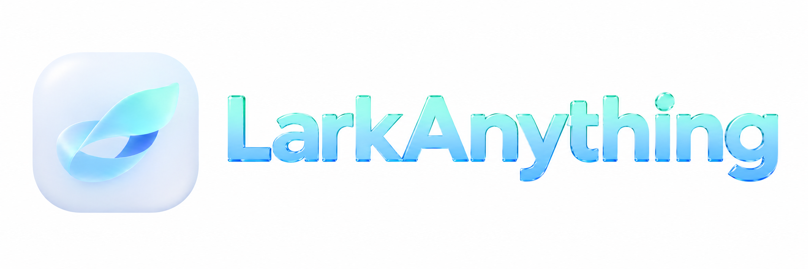

[English](README.md) | **简体中文**

**将 AI 对话与文档整理成可编辑的飞书 / Lark 文档。**

LarkAnything 是适用于 Windows 和 macOS 的轻量桌面 App。选择来源，挑选会话或文件，预览后上传到飞书；保存文件夹可以在设置中指定。无需模型 API Key，也不会调用 AI 改写原文。

## 下载与安装

当前桌面版本：**0.1.0 Preview 1** · [发布说明与校验文件](https://github.com/Hans-M-Yin/LarkAnything/releases/tag/desktop-v0.1.0-preview.1)

| 平台 | 下载 | 安装方式 |
| --- | --- | --- |
| Windows x64 | [EXE 安装程序 · 约 15 MB](https://github.com/Hans-M-Yin/LarkAnything/releases/download/desktop-v0.1.0-preview.1/LarkAnything_0.1.0_x64-setup.exe) | 双击，按向导安装 |
| Apple Silicon Mac · macOS 13+ | [DMG · 约 21 MB](https://github.com/Hans-M-Yin/LarkAnything/releases/download/desktop-v0.1.0-preview.1/LarkAnything_0.1.0_aarch64.dmg) | 打开 DMG，将 App 拖入 Applications |

**不需要 Git、Node.js、Rust、Xcode，也不用执行终端命令。** 两个平台的安装包均内置官方飞书 CLI 1.0.98。Windows 若缺少 WebView2，安装器会联网安装微软共享运行库。本版暂不提供 Intel Mac 和 Windows ARM 原生安装包。

当前为**预览版**：Windows 尚未使用发布者证书签名；Mac 使用 ad-hoc 签名，尚未完成 Apple Developer ID 签名和公证。系统可能提示未知开发者，处理方式见[安装说明](docs/DESKTOP-INSTALL.md)。Mac 打包与自动检查已通过，真机安装、授权与界面仍待测试。

## 第一次使用

1. 打开 App，按连接引导创建飞书应用，或填写自己的 App ID 和 App Secret。组织权限可能需要管理员协助。
2. 在浏览器完成本人账号授权，返回 App 确认。无需额外运行凭证修复工具。
3. 选择来源，再挑选会话、页面或文件；需要时在设置中指定飞书目标文件夹。
4. 检查预览后上传，App 会回读文档核验结果。

App 会列出可选内容，由你确认要上传哪一项，不会根据其他 App 的窗口猜测当前文档。授权和上传需要联网；安装包不包含开发者账号凭据或用户文档。

## 支持的桌面来源

| 来源 | 选择方式 |
| --- | --- |
| Codex | 从本机会话日志中选择对话 |
| Claude Code | 选择本地会话 |
| Obsidian | 设置 Vault 后选择 Markdown 笔记 |
| OpenCode | 通过本机已安装的原生 CLI 列出并导出会话 |
| Notion | 配置集成并授予页面访问权限后选择页面 |
| Markdown | 使用文件选择器选择 `.md` 文件 |
| Microsoft Word | 使用文件选择器选择 `.docx` 文件，无需安装 Word |

所有来源统一进入 Core 的转换、预览和上传流程。Notion 令牌保存在 Windows 凭据管理器或 macOS 钥匙串中，重启自动使用；飞书连接配置及 CLI 管理的登录凭据也会保留，密钥不会复制到 App 的 JSON 配置中；文件导入上限为每个文件 20 MB。DOCX 支持正文、标题、列表和表格，不保留图片与复杂版式。另可通过 CLI/SDK 处理 ChatGPT 导出的 JSON。

## 设置、更新与数据

- 飞书保存位置、来源路径、外观和连接可以在界面中设置；CLI/SDK 的高级格式选项另有文档。
- 更新前退出 App：Windows 运行新版安装程序，Mac 用新版替换 Applications 中的应用。
- Windows 通过系统“设置 → 应用”卸载，Mac 将 App 移到废纸篓。卸载保留 `~/.larkanything` 中的配置和上传回执，也不会撤销飞书授权。
- 本地预览可能含私人内容，原始来源文档不会被修改。请保留上传回执：写入结果未知时，程序会暂停自动重传，避免重复文档。

会话来源在历史和身份可确认时支持增量发布；Notion 页面与导入文件以快照方式新建文档。暂不支持图片上传、双向同步和后台监控。转换限制及飞书权限可能影响结果；回读核验文字内容，不保证视觉排版完全一致。

## 可选：CLI、Skill 与 SDK

需要由 Agent 发起导出、编写自动化或接入自定义来源时，参阅 [CLI、Skill 与 SDK 指南](docs/CLI-AND-SDK.zh-CN.md)、[Agent 安装说明](INSTALL.md)及 [TypeScript 接口](https://github.com/Hans-M-Yin/LarkAnything/tree/desktop-v0.1.0-preview.1/src/index.d.ts)。这些是可选用法，具有独立的开发与运行环境要求。

## 从源码开发

标准桌面版采用 Tauri、Rust 和 React，统一在 `main` 维护。已发布预览版仍对应标签 `desktop-v0.1.0-preview.1`。

开发与打包请参考 [Windows 与 Mac 构建说明](docs/BUILD.md)：

```bash
git clone https://github.com/Hans-M-Yin/LarkAnything.git
cd LarkAnything
npm ci
npm run check
npm run desktop:check
npm test
```

原生打包还需要 Rust 及对应平台的构建工具。[发布工作流](.github/workflows/desktop-release.yml) 分别构建 Windows x64 和 Apple Silicon 安装包，内置官方 CLI 并生成 SHA-256 校验清单。历史 Electron / SwiftUI 实现可从 Git 历史回溯，当前桌面构建入口统一使用 Tauri。

MIT License。独立社区项目，与 OpenAI、Anthropic、飞书或 Lark 官方无隶属关系。内置组件与字体保留各自许可证。
