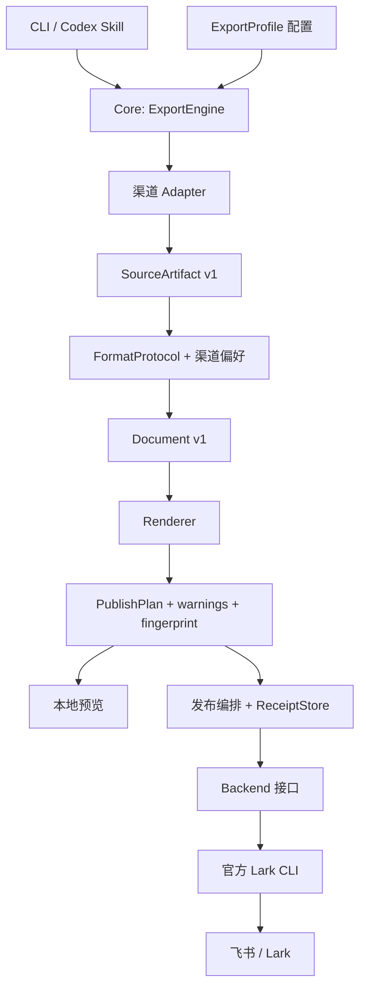
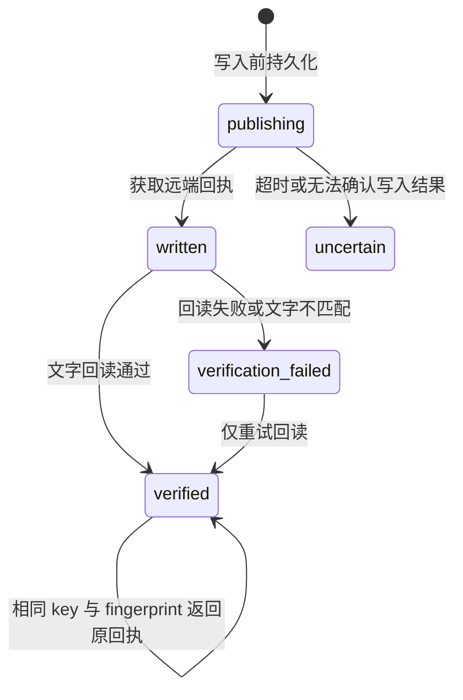

# LarkAnything 架构

## 目标与首版范围

长期目标是把不同来源的内容，按用户的语义与格式偏好发布到飞书的合适协作对象。首版实现 AI 对话到飞书文档，优先验证来源解析、结构化内容、格式协议、发布操作和回执状态之间的边界。

代码是单一 npm 包内的模块化实现。先建立可执行的边界与版本化契约，再按实际部署需求拆包/拆服务。飞书访问后端在这里指集成组件；首版不要求用户部署一台 HTTP 服务器。

## 依赖关系



`src/core` 不导入具体渠道、协议或后端；`src/index.mjs` 是组合入口，注册内置实现。后端不认识 Codex/Claude 日志。协议不处理 OAuth、HTTP 或资源创建。渠道不决定飞书目标位置。

## 三种不同的“协议”

名称上需要区分三个概念：

| 概念 | 决定什么 | 首版位置 |
| --- | --- | --- |
| Source adapter/schema | 如何读懂某客户端的日志、分支、消息与附件 | `src/adapters` |
| FormatProtocol | 哪些内容进入结果，角色、标题、时间戳和段落如何组织 | `src/protocols` |
| Backend transport | 如何认证、创建资源、追加内容和回读 | `src/backends` |

一个渠道可以使用多个 FormatProtocol。同一个 Protocol 可以服务多个渠道。渠道偏好作为配置覆盖，不复制一套协议实现。发布目标和操作是 ExportProfile 的另一部分，独立于格式偏好。

## 已实现的扩展接口

完整定义在 [`src/index.d.ts`](../src/index.d.ts)。接口实现都包含稳定 `id` 和接口版本 `version: 1`；id 重复注册会失败。

| 接口 | 输入 → 输出 | 扩展实例 |
| --- | --- | --- |
| `Adapter.load` | 来源引用 → `SourceArtifactV1` | 增加 Cursor、Gemini CLI 或用户自己的客户端 |
| `FormatProtocol.format` | 声明支持的 source kind + 格式参数 → `DocumentV1` | 完整对话、问答摘录、成果文档 |
| `Renderer.render` | `DocumentV1` → 传输正文、扩展名、警告与校验文本 | Markdown、后续 DocxXML/原生 Block |
| `Backend.publish/verify` | `PublishPlan` → 远端回执/验证结果 | CLI 后端、后续 OpenAPI 或托管服务 |
| `ReceiptStore` | key → 回执，附带原子更新与互斥锁 | 本地文件、后续 SQLite/服务端存储 |

SDK 注册的扩展是用户信任的代码。首版不从配置文件自动下载或执行第三方模块。CLI/Skill 共用 SDK；浏览器扩展、MCP 和桌面壳是后续应用入口，可以调用同一核心流程。

个人安装入口是 `scripts/install.mjs`：将一份独立运行程序安装到用户目录 `.larkanything/runtime`，为 Codex/Claude Code 注册标准个人 Skill。Skill 的 `scripts/run.mjs` 通过安装指针定位程序与默认配置；源码目录可删除。安装器只管理程序依赖与注册，不处理会话内容或代替用户授权。它复用系统 Lark CLI，缺少时私有安装官方包，不修改全局 npm、shell 或其他 Agent 设置。插件市场包仍作为可选分发形式保留。

## 内容模型

SourceArtifact 的公共字段是 `version/kind/id/title/source/warnings`。当前内置来源返回 `kind: conversation`，包含有序 messages。每条消息包含稳定 id、角色、可选时间戳与结构化 content parts。

消息可携带 `turnId`、`model`、`modelSource`（`message` 或 `turn_context`）、`phase`（公开的 `commentary` 或 `final`）。Adapter 负责从对应日志提取事实：Codex 轮次开始/结束会重置模型上下文，避免把上一轮模型误填到下一轮；内部 reasoning/analysis 不进入消息。Protocol 负责按轮次和用户边界分组，同时保留每条原始消息与每一步的元信息。未知轮次按相邻助手消息合并，已知和未知边界之间不跨越合并。

ContentPart 已区分：

- `text`：区分 plain 与 markdown。
- `code`：独立保留语言与原始内容。
- `tool`：独立选择是否导出，避免混入普通回答。
- `image`：保留来源引用；当前只生成链接。
- `unsupported`：保留可读占位与明确诊断，避免静默消失。

协议输出的 Document 节点包含标题、段落、元信息（`metadata`）、递归引用容器（`quote.children`）、步骤容器（`step.label/children`）、Markdown、代码、图片、分隔符，并尽可能保留 `sourceMessageId`。每段回复只生成一次时间范围与模型元信息；明确标为公开过程的消息及工具步骤进入引用容器，最终答复和未知阶段保持正文。每个过程步骤仅添加简短编号。Renderer 先转换引用内的内容，再逐行引用，保留代码、表格和嵌套引用的结构。`coverage.publishedMessages` 保留原始消息数量，`displayGroups` 与 `mergedAssistantMessages` 记录展示分组与合并数量。这让未来的消息级更新能建立源消息与远端块的映射。

核心只验证 SourceArtifact 的公共字段。后续网页/本地文件 Adapter 可以返回新的 kind，注册声明 `inputKinds` 的相应 Protocol。测试中已有非 conversation 来源通过新 Protocol 和新后端操作生成计划，验证了这条扩展路径。

格式保真与智能整理分开演进。首版采用确定性转换；未来调用模型生成摘要/行动项时，应作为显式转换步骤保存来源对应关系，不能覆盖原始归档内容。

### Codex 会话组装与来源证据

会话是逻辑来源，JSONL 是物理分段。Discovery 读取首条 `session_meta`，按真实 id 聚合 `sessions` 和 `archived_sessions` 下的分段；不进入 subagents，不跟随目录符号链接。文件名仅作为缺失元数据时的兼容定位线索，不能覆盖已记录的身份。`resolveSessionSources` 返回来源数组；旧的单文件 `resolveSession` 在多段时明确报错，避免调用方继续漏读。

Adapter 对每个分段执行一次文件读取，用同一份字节生成指纹和解析结果，提取轮次上下文，再组装消息。消息 id 或带时间戳的相同原始记录可证明重复；无 id 记录按出现次数对齐，不折叠真实的重复提问。相同 id 的正文或模型/轮次/阶段冲突会停止。仅有相似文本、前缀关系或不同身份的重复记录时，保留并给出诊断。完整的 Skill 注入封装与环境注入按结构过滤，助手正文不按这些标签过滤。

`SourceArtifact.source.manifest` 和计划保留来源路径、SHA-256、字节数、记录数、组装后的角色数量，以及注入过滤、重复删除和歧义保留数量；Adapter 消息的 `sourceRefs` 记录文件与行号。`scope: local-session` 的 `complete` 只覆盖准备时可发现的本机分段，不证明已删除/远端历史存在；单文件范围标记 unknown，fork 父前缀未加载标记 partial。发现疑似目标分段但无法确认身份时停止，避免静默忽略。

## 配置分层

```text
内置默认值
  → defaults
  → channels[channel]
  → profiles[profile]
  → 本次 CLI/SDK overrides
```

对象递归合并，标量覆盖。协议验证自己的 format 参数；后端验证自己的目标参数和 capabilities。未知参数报错，避免拼写错误被忽略。

`target` 包含后端、操作、目标及 namespace，并预留结构化 `params` 给后续后端操作。默认 `sync` 是 Core 的会话发布策略，准备阶段将它解析为后端的 create/append；LarkCliBackend 仍只声明实际支持的 create/append。其他自定义后端操作按其 capabilities 校验。

认证属于后端。首版由官方 CLI 管理用户/bot 身份、区域、令牌与续期。配置中只保存命令位置、身份选择、超时等非秘密信息。未来 REST 后端可以注入 CredentialProvider，同时复用 Core 与上层渠道。

## 计划与发布

准备阶段是本地、可检查的过程：

```text
load source → validate kind → resolve protocol → format → render
→ validate backend capabilities → fingerprint → PublishPlan
```

计划包含实际正文、转换警告、覆盖数量、目标和完整 fingerprint；不以“计划中的行为”代替真实正文。HTML 预览由对应 Renderer 提供。Preview 不启动 CLI 后端。

CLI 的 `publish --session` 一次调用即可完成准备、预览、发布、回读。`publish --plan FILE` 发布冻结计划，不重新读取来源；不能同时覆盖来源、格式或目标。预览后的确认与失败重试均使用该路径，防止活跃会话增长后改变正文和默认幂等键。计划仍验证 fingerprint 与后端身份配置。

`sync` 按渠道、会话 ID、后端、身份 scope、namespace 和父目录生成会话关联键。ReceiptStore 用保留的 `larkanything:session:` 键保存最新发布回执和消息 checkpoint；checkpoint 只存所选消息的 ID/哈希与展示分组数，不存正文或来源路径。`FormatProtocol.selectMessages` 声明可增量导出的消息，`format` 的可选 context 接收 `append/groupOffset`；内置 transcript 不重复追加整篇标题与会话元信息。其他协议可以实现同一接口，或显式选择 create 等后端操作。

准备阶段比较已发布消息是否仍是当前消息的完整前缀；历史修改、缺失或分支变化会停止。只对新增后缀生成正文，编号接续；无新增内容时生成空的增量计划，发布直接复用远端回执。文档开头的统计与时间范围保留首次快照。显式 create/append 不建立会话关联，旧版回执也不会被猜测迁移。

发布时先持有会话锁（仅 sync），再持有 export key 锁，核对计划的前一版本后读取/写入回执。正文通过子进程 stdin 交给 CLI，使用参数数组并禁用 shell，避免代码文本成为命令。会话关联在远端写入前记录 pending 状态；未完成的发布阻止新的增量计划，避免会话继续增长后绕过未知写入结果。回执文件与关联文件之间的中断通过读取关联指向的最新回执恢复。已验证的旧计划可以安全返回原回执；未执行的过期计划必须重新准备。



关键保证：

- 相同 key、不同 fingerprint 报冲突。计划被修改后 fingerprint 不匹配，也会拒绝发布。
- 有回执但回读失败，保留文档 id，重试只读。
- 未知写入结果不自动重放。进程可能在远端成功、回执落盘前退出；首版明确报告这个事务缺口。
- FileReceiptStore 使用原子 rename 和独占锁，回执文件权限 0600，目录创建权限 0700。崩溃后的锁需要人工核查；不会凭超时自动接管仍可能进行的发布。
- 幂等范围是同一状态目录与配置 namespace。分布式/跨机器幂等需要共享存储，不在首版保证内。
- 回读比较规范化 Markdown 的完整文字序列，行内代码和代码块使用保留空白的独立编码。仅在来源链接边界容忍空白增减，并在 `verification.normalizations` 中明示；不全局删除空白。失败返回短差异、类别和偏移，随正式回执保存；它不能证明视觉布局或所有来源都可用。

首版不自动覆盖文档，也不隐式扩大共享范围。sync 只追加新增消息，显式 append 仍表示追加本次整个结果；不修改已发布块。远端人工编辑的检测与合并、消息到 block 的更新映射仍未实现。

Skill 只负责解析用户选择、调用程序和报告结构化结果。它不读取原始日志判断内容是否完整，不组装 generic 替代来源，不用模型或临时脚本过滤记录，不用自行归一化的比较覆盖失败回执。回读失败通过同一冻结计划重试；写入结果未知时保持不自动重放。

## 渲染边界

使用维护中的 markdown-it 解析 Markdown，而不自己实现一套 Markdown 语法。源码正文保留普通表格、代码围栏和行内样式，由官方 CLI 转为原生飞书文档。

为了保护消息结构和本地资源：

- 文档正文从 h1 开始，消息 h2，消息内部标题下移到 h3 及以下。
- 未闭合的代码围栏在消息末尾补齐，防止吞掉后续轮次。
- 对话里的 XML/HTML 尖括号作为文本处理，不能变成 CLI 的原生上传标签。
- Markdown 图片变成可点击链接；不会因为导入一段对话而隐式读取本地图片文件。
- HTML 预览不加载脚本或远程资源。
- 已识别的降级生成 warning；strict 模式停止。工具日志按配置排除属于选择范围，单独报告。

公式在 Markdown 解析前提取并暂存为不会与原文碰撞的标记。计划和预览使用 XML 转义的 `<latex>…</latex>` 保存原始源码。后端发布时解码为美元定界公式，避免 Markdown 导入将 XML 实体当成 TeX；先按原行边界移除未转义的 `%` 注释，再将换行替换为空格，保留矩阵分行命令。回读使用相同源码布局归一并记录 `math-source-layout`，不放宽代码、公式内容或矩阵结构检查。代码、链接目标和转义定界符不转换；普通来源 XML 与正文美元符号保持转义。HTML 预览用 KaTeX 输出离线 MathML，关闭信任能力并限制展开和尺寸；解析失败时保留可读源码。

回读将原生公式及飞书导出的美元定界公式归一为同一种带结构的源码序列，普通文本无法冒充公式。明确含旧 `MATH_NOT_VERIFIED` 警告的冻结计划可用原有文字契约重试，回执记录 `legacy-math-as-text`；只要期望正文包含原生公式，就不能走此兼容路径。代码空白和仅来源链接边界的空白兼容规则保持不变。

v0.1 未实现完整的媒体解析/上传、Mermaid 图表、脚注与复杂嵌套结构保真。飞书支持的 LaTeX 命令与 Markdown 扩展语法仍需真实租户样例持续验证，不能将本地 HTML 的效果当作飞书效果。

## 新能力应该放在哪里

| 新需求 | 实现位置 | 需要改变 Core？ |
| --- | --- | --- |
| 新 AI 客户端会话文件 | Adapter + 兼容性样例 | 不需要 |
| 每渠道不同角色名/时间戳偏好 | channels 配置 | 不需要 |
| 新的归档结构/摘要布局 | 新 Protocol | 不需要；模型调用应显式实现 |
| 更好的飞书原生格式 | Renderer + 后端 capability | 通常不需要 |
| 飞书 REST/OAuth 代理 | 新 Backend/CredentialProvider | 不需要改变渠道 |
| 更可靠的跨机器发布回执 | ReceiptStore 实现 | 不需要 |
| 浏览器按钮/MCP | 新应用入口调用 SDK | 不需要改变处理链路 |
| 已发布块更新、远端人工编辑冲突合并 | 发布策略、远端 block 映射 | 需要进一步扩展发布状态协议 |
| 多维表格、任务、幻灯片 | 新资源模型/Protocol/Renderer/Backend capability | 需要显式版本化资源契约 |

最后两项需要真实的契约演进；这里没有用空方法或假 capabilities 宣称已支持。

## 决策依据与验证

- [OpenAI 插件打包规范](https://developers.openai.com/plugins/build/plugins)：Skill 与运行资源放在同一插件根目录，并提供 Git-backed marketplace。
- [Lark CLI](https://github.com/larksuite/cli)：首版复用其身份、文档和区域适配能力。
- [官方 Markdown 参考](https://github.com/larksuite/cli/blob/main/skills/lark-doc/references/lark-doc-md.md)：stdin 传参、Markdown 导入和 XML 扩展标签的行为。
- [markdown-it](https://github.com/markdown-it/markdown-it)：本地 Markdown 解析与预览。

本地验证使用合成数据及模拟 Lark CLI 子进程，不读取用户真实历史，不向飞书写入测试文档。CI 配置覆盖 Node 22/24 和 Linux/macOS/Windows；是否通过以真实 CI 结果为准。
